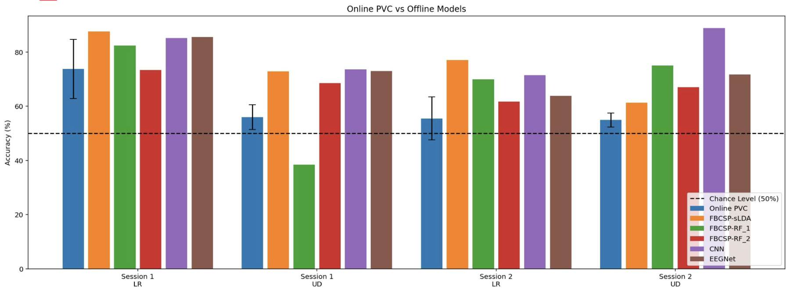

# Improving Motor-Imagery Brain–Computer Interface Classification

Offline decoders that beat the original online classifier of a 64-channel EEG motor-imagery BCI, comparing Common Spatial Patterns, Filter-Bank CSP and classical classifiers against deep learning (CNN, EEGNet).

*Group 1: Micah Baldonado, Dheemant Jallepalli, Defne Kudug, Alexis Valencia, Joseph Zhang, J.D. Kline — Brain–Computer Interfaces (Prof. Bin He), Carnegie Mellon University, Spring 2025*

  

Offline models vs. the online classifier (percent valid correct), per session and task. Dashed line: chance (50%).

## The experiment

- Participants **imagine** moving their left vs. right hand (LR task), or both hands vs. none (UD task), without moving.
- Motor imagery changes the **sensorimotor rhythm**: mu (8–13 Hz) and beta (13–30 Hz) power drops over the opposite motor cortex (C3 for the right hand, C4 for the left).
- EEG was recorded with a **64-channel cap**. The online BCI used a small set around C3/C4; offline we used about **27 gelled channels** across the FC–C–CP rows for more spatial information.
- **Metric:** PVC (Percent Valid Correct), the share of non-aborted trials where the classifier moves the cursor the right way. It matches how the online classifier (FT + Burg AR + 1-D LDA on C3/C4 alpha power) is scored, so the comparison is fair.

## Pipeline

1. **Pre-processing:** select the motor region of interest, band-pass 8–30 Hz, common average reference, down-sample, and drop trials that are too short or aborted (optional Laplacian / ICA).
2. **Features:**
   - **CSP** spatial filters that maximise variance for one class and minimise it for the other (5 pairs worked best).
   - **FBCSP**: CSP per frequency band (4–40 Hz in 4 Hz bands) with **Mutual-Information Best Individual Feature (MIBIF)** selection.
3. **Classifiers:** LDA, shrinkage LDA, SVM and random forest on CSP/FBCSP features.
4. **Deep learning:** an MLP and a CNN on CSP features, a feature-fusion network, and **EEGNet** on raw EEG.

## Results

- **Every offline model outperformed the online classifier.** CSP/FBCSP learn spatial patterns across many electrodes, and deep models capture non-linear structure the online linear decoder cannot.
- FBCSP + random forest reached **81.5% PVC on the LR task** (62.1% on UD).
- The CNN reached about **85% test accuracy** (subject 1, LR) and **89%** (subject 2, UD).
- No single model won outright: CSP/FBCSP + LDA performed close to the best deep models. In BCI, **pre-processing drives performance**.

## Limitations and future work

- EEG is a time series, and 5-fold cross-validation mixes trials across time, so some data leakage is possible. With only 329 valid trials, a single chronological split was too unstable.
- Next steps: run these classifiers online, and test on more subjects for better generalisation.

## Repository contents

| File | What it is |
|---|---|
| `CNN_MLP_LDA_BCI_Project.ipynb` | Pre-processing, CSP, train/test splits, and the MLP/CNN models (PyTorch) |
| `BCI_Presentation.pptx.pdf` | Final presentation with all figures and results |
| `images/` | Figures used in this README |

## References

- Lawhern, V. J., et al. (2018). EEGNet: a compact convolutional neural network for EEG-based brain–computer interfaces. *Journal of Neural Engineering*, 15(5), 056013.
- Ang, K. K., Chin, Z. Y., Zhang, H., & Guan, C. (2008). Filter Bank Common Spatial Pattern (FBCSP) in brain–computer interface. *IEEE IJCNN*.

Thanks to Prof. Bin He and Yidan for their help with this project.
